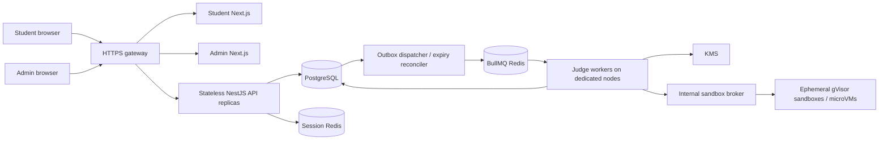

# Architecture and capacity

This is the preserved Step 1 architectural design. Steps 2–4 now implement student auth,
dashboard, Monaco workspace, durable attempts/drafts and judge/grading orchestration within
these boundaries. See [current Step 4 behavior](step-4.md) and its [Linux release gate](judge-test-gate.md).

## Scope and trust boundaries

Student and admin are independent Next.js App Router applications with strict TypeScript,
Tailwind 4, shadcn/ui configuration and a local Button primitive, and TanStack Query providers.
Student dependencies include React Hook Form, Zod and its resolver. Monaco was added in Step 3.
Each app has feature-local components/hooks/schemas/adapters; shared root `contracts/` is a set
of source files, not a fourth application or workspace package.

NestJS is a modular monolith for the control plane. Each feature owns its API boundary, use
cases, repository contract, DTO aliases, policy contract and deferred acceptance tests. Modules
are bootstrappable but deliberately empty. Redis/BullMQ, Prisma, Argon2 and OpenAPI dependencies
are configured; these integrations are not connected to feature behavior yet.

Browsers never receive database credentials, execution credentials, hidden cases, full ORM rows
or internal worker artifacts. They communicate with NestJS through a same-origin API path.
Next.js server components also use authorized HTTP contracts rather than direct SQL.
The judge broker is a deployment component of `backend/`, not another application folder.

## Ownership

| Feature     | Responsibility                                                                |
| ----------- | ----------------------------------------------------------------------------- |
| auth        | Existing identity adapter, Argon2id verification, sessions, CSRF, role guards |
| students    | Own profile, enrollment lookups; credential-free admin listings               |
| assessments | Schedules, frozen rules/pool, assignment eligibility                          |
| questions   | Question identities, immutable version publication, safe public projection    |
| attempts    | Start/resume, allocation, draft revisions, deadline checks, finalization      |
| submissions | Immutable source snapshots, deduplication, status retrieval                   |
| execution   | Admission, public runs, worker/broker contracts                               |
| results     | Final-snapshot aggregation, release policy, audit of later regrades           |
| admin       | Authorized management orchestration through owning feature services           |

Controllers never transact across repositories themselves. Services define transaction scopes.
Repositories accept a `Prisma.TransactionClient`. Cross-feature behavior uses explicit service
contracts; do not import another feature's repository or expose Prisma response types.

## Capacity plan — engineering assumptions, not measured guarantees

Start with 3 API replicas (2 vCPU / 2–4 GiB each), 2 frontend and 2 admin replicas behind the
gateway, a PostgreSQL instance (4–8 vCPU / 16 GiB / SSD as a starting point), separate production
Redis deployments for sessions and durable queues, and dedicated judge nodes. Tune these using
the intended workload. Next.js shells and assessment control requests do not execute code.

At 500 students, autosave every 5 seconds with jitter is about **100 writes/s** at most when
everyone is editing. Resync every 30 seconds is about **17 reads/s**; display countdown locally
between synchronizations using `meta.serverNow` and `expiresAt`. Submission polling uses
2-second intervals while active, then exponential backoff; do not poll all historical jobs.
Draft saves debounce, collapse unchanged buffers, and preserve revisions and unsent source.
These assumptions are inputs to a load model, not permission to relax the server deadline.

Assume one judge request per student per minute: **8.33 jobs/s**. At **3 seconds measured mean
job service time**, offered concurrency is approximately 25 execution slots. Provision 40 slots
initially for headroom (for example 10 judge orchestrators, 4 slots each) and verify p95 latency.
Slots consume CPU/memory on dedicated sandbox nodes, including Java overhead and compilation.
Scale for actual mean service time; 40 slots is insufficient if average job cost exceeds 4.8
seconds at that request rate. The security ceilings are larger than this assumed mean.

500 simultaneous requests produce a queue burst: at 40 slots and 3 seconds/job, draining 500
jobs takes roughly 38 seconds before retries and overhead. 2,000 final snapshots at expiry take
roughly 150 seconds under the same assumption. Finalization freezes source immediately; scoring
finishes asynchronously. Communicate queue state, use fair admission, and reserve separate worker
capacity for final jobs. Hidden grading latency never extends an attempt deadline.

Use explicit PrismaPg pools: 3 API replicas × 20 + 10 judge processes × 4 + 2 maintenance
processes × 4 = **108 connections** as a starting budget under a 150-connection PostgreSQL limit.
Do not hold SQL connections while compiling or running code. Consider PgBouncer transaction
pooling when replicas grow; migrations use a direct URL. Set database role/timeouts, query
budgets and lock retry limits. HTTP connection count is unrelated to database connection count.

Production queue Redis uses persistence, `noeviction`, TLS, ACLs, managed failover and backups.
Session Redis can cache revocation-aware sessions, but PostgreSQL session records remain durable.
The development container uses separate Redis logical DBs for convenience; this is not production
isolation. Outbox reconciliation can recover from loss of queued Redis jobs.

## Reliability and observability

Use at-least-once delivery with durable deduplication, leases and fencing generations. Log request,
attempt, submission and job IDs with Pino. Never log credentials, cookies, code, test payloads or
hidden stdout/stderr. Trace API → outbox → job → sandbox using internal identifiers.
Measure API p50/p95/p99, active attempts, draft conflicts, DB pool wait, locks, queue depth/age,
judge service time, infrastructure failures, finalization lag and reconciliation health.

Later readiness checks must verify database/Redis connectivity and separate judge/broker readiness.
Shutdown must stop admissions, drain bounded API requests, renew in-flight leases or release them,
and terminate sandbox resources. Outages reject unsafe writes with 503; they never pretend code
was saved, submitted, executed or graded. No success-returning readiness stubs exist in this step.

Acceptance load test: 500 authenticated students for 3 hours, synchronized start burst, four
questions each, autosave/resume traffic, normal runs/submits, disconnect/reconnect, worker restarts,
Redis failover and 2,000 final snapshots at synchronized expiry. Initial targets: API p95 below
300 ms excluding judge work, no acknowledged write loss, no duplicate attempts/finalization, no
post-deadline writes, and bounded queue lag with published workload assumptions. Repeat with
worst-case allowed code and compilation. Deployment sizing is accepted only after these checks.

The API example contains only its own database/session settings and public-case key identifier.
Judge and maintenance have separate environment examples and Zod schemas in `backend/src/config/`.
Hidden-case KMS access and judge SQL credentials never belong in the API or either Next.js deployment.
Workload identity supplies mTLS/KMS authorization; key IDs alone grant no access.

Production image digests, runtime SQL grants, KMS policies and a patched base-image pipeline must
be provisioned before deployment. Development Compose versions are explicit tags, not immutable
production artifact digests. Image references were checked against the official
[PostgreSQL](https://github.com/docker-library/postgres/blob/master/versions.json),
[Redis](https://github.com/docker-library/redis/blob/master/versions.json) and
[NGINX](https://github.com/nginx/docker-nginx/blob/master/stable/alpine-slim/Dockerfile) image sources.

Framework choices follow [Next.js installation](https://nextjs.org/docs/app/getting-started/installation),
[NestJS modules](https://docs.nestjs.com/modules) and
[Prisma 7 generation](https://www.prisma.io/docs/orm/v7/prisma-schema/overview/generators).
