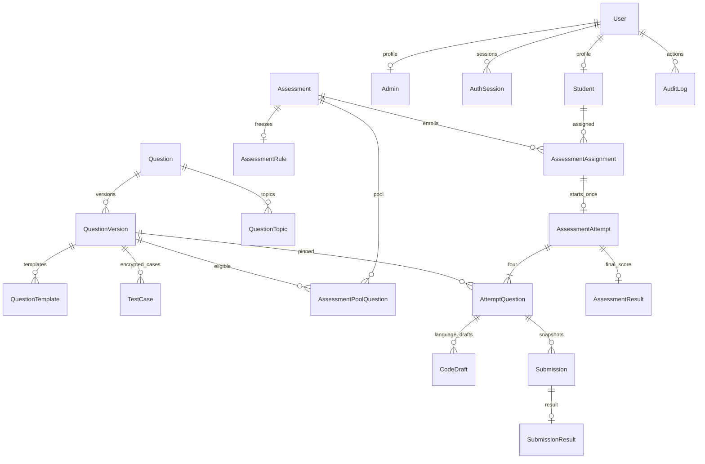

# Database schema and safe migration strategy

Step 4 adds execution/grading metadata and immutable result protections through one additive
migration. See [current behavior](step-4.md) and optional [runtime grants](../backend/prisma/runtime-grants.sql).
The original new-install/adoption safeguards below still apply; no production connection was used.

## Inspection result and compatibility boundary

The original workspace contains `Questions/` and no application, `.git`, `AGENTS.md`, Prisma
schema, SQL migrations, existing user model or database connection configuration. The local JSON
inventories contain 417 question-bank and 453 raw records. Spreadsheet and JSON assets were not
changed, imported or seeded. No production system was contacted or reset.

`User` maps to `users` for a **new installation**. Its UUID ID, email, hash, role and timestamps
are proposed fields only. Existing schemas may use integers, usernames, nullable email, another
hash field, external authentication or separate roles. The generated new-install migration must
not be used to adopt them. Login cannot be claimed compatible until the actual schema is inspected.

## Model and key map

| Model                  | Keys, integrity and purpose                                                                                |
| ---------------------- | ---------------------------------------------------------------------------------------------------------- |
| User                   | UUID PK, unique email, mapped `users`; hash, active flag, role and authVersion                             |
| Student                | UUID PK, unique user FK and external ID; enrollment identity                                               |
| Admin                  | UUID PK, unique user FK; audited administrative identity                                                   |
| Assessment             | UUID PK, creator Admin FK, indexed status/open time, optimistic revision                                   |
| AssessmentRule         | UUID PK, unique assessment FK; frozen 10,800 seconds, 2/1/1 composition and policy versions                |
| Question               | UUID PK, unique slug; stable identity and soft archive                                                     |
| QuestionTopic          | composite question/topic PK; explicit association and topic/question index                                 |
| QuestionVersion        | UUID PK, unique question/version and id/question pairs; published immutable content/limits/hash            |
| QuestionTemplate       | UUID PK, unique version/language FK pair; starter source and toolchain reference                           |
| TestCase               | UUID PK, unique version/ordinal; encrypted inputs/outputs, visibility, weight and integrity hash           |
| AssessmentAssignment   | UUID PK, unique assessment/student and id/student/assessment pairs                                         |
| AssessmentAttempt      | UUID PK, unique assignment and assessment/student; composite assignment ownership FK and exact deadline    |
| AttemptQuestion        | UUID PK, unique attempt/position and attempt/question; composite attempt, pool and version FKs             |
| CodeDraft              | UUID PK, unique allocated-question/language; composite owning attempt FK, revision/hash/time               |
| Submission             | UUID PK, unique attempt/idempotency key; composite allocated-question/attempt/version FK, immutable source |
| SubmissionResult       | UUID PK, unique submission FK; aggregate/internal diagnostics and worker generation                        |
| AssessmentResult       | UUID PK, unique attempt FK; frozen-policy aggregate and release state                                      |
| AuditLog               | UUID PK, nullable actor FK with Restrict; append-only action/entity/request metadata                       |
| AssessmentPoolQuestion | composite assessment/version/question PK, unique assessment/question; pinned eligible pool                 |
| AuthSession            | UUID PK, unique token digest, user FK, expiry/revocation indexes                                           |
| OutboxEvent            | UUID PK, unique event dedupe key; indexed pending/available/created dispatch scan                          |
| IdempotencyRecord      | UUID PK, unique user/operation/key; payload hash, durable response and expiry index                        |

All modeled foreign keys use `onDelete: Restrict`. No cascade can erase attempts, submissions,
results or immutable versions. Deactivate users, archive questions and assessments, and retain
audit references. Retention/deletion requires a separately reviewed archival procedure. Indexes
cover FK lookups, student schedule/attempt history, expiry reconciliation, submission status/leases,
queue dispatch and audit chronology. Avoid indexing source code, ciphertext or entire JSON blobs.
All persisted dates use UTC-compatible `timestamptz(3)`; exact scores/weights use Decimal(10,2).

## SQL protections beyond Prisma

The checked-in new-install migration combines Prisma-generated DDL with `prisma/invariants.sql`:

- Fixed exam duration/counts/languages/source ceiling and full three-hour schedule constraints.
- Bounded version limits, positive scores/weights and draft/source byte limits.
- Published-version/child immutability with parent locks against concurrent publication.
- Frozen assessment schedules, rules and version pools once scheduled.
- Deferred commit-time validation of exactly four questions with the 2/1/1 difficulty mix.
- Immutable allocated identities/positions, immutable source snapshots and correct final-submission ownership.
- Append-only audit records and a filtered view of public test-case envelopes.

Prisma cannot represent these triggers/checks/view semantics fully. Review/preserve custom SQL
in every subsequent migration; schema generation alone does not prove they behave correctly.
`schema.prisma` defines structural integrity; services must additionally enforce authorization,
CSRF, row-lock timing, allowed state transitions, request-size limits, role/profile consistency and
fenced worker commits. Do not expose a generated Prisma model as an API DTO.

Production runtime roles require separately reviewed grants: API reads approved tables/public-case
view and updates owned domain tables; it cannot SELECT `test_cases` or diagnostics. A question-write
connection has controlled draft upload privileges. Judge can read encrypted cases and write its
claimed result; only its KMS identity decrypts hidden data. Migration owner is never the API user.
Do not use the development PostgreSQL superuser for production. Roles, grants, KMS policy and
row-level access testing are later deployment gates, not an implied protection of a default connection.

## Empty installation

1. Confirm the target database/schema is empty and dedicated to development; retain connection
   identity separately from any production credential.
2. Inspect the checked-in migration SQL. It starts a transaction and aborts if `users` already
   exists. It creates tables and enum types, then applies the SQL protections, and commits.
3. Use `prisma migrate deploy` only against that empty installation. Never run `migrate reset`
   or accept a drift tool's request to reset an existing database.
4. Generate the client explicitly with `pnpm db:generate` (Prisma 7 no longer implies generation
   on migration). No users/question seed exists in Step 1.
5. Before production, apply and verify on a disposable PostgreSQL 17 instance, including
   concurrent starts/saves/publication and invariants. Back up and rehearse restoration.

## Existing users / production adoption

1. Obtain a read-only connection, schema-only export and verified backup. Do not print rows,
   hashes or connection secrets. Introspect to a **separate temporary schema file**, never overwrite
   the reviewed schema directly: `prisma db pull --print > artifacts/existing-schema.prisma`.
2. Match the actual users table name/schema, PK type, identifier semantics, password hash field,
   timestamp types, active flags and existing role/provisioning rules. Keep original IDs and hashes.
   Adapt every User FK type to the actual key. Use `@map` / `@@map`; do not rename identity columns
   merely to match this proposal. Additional auth metadata may live in an additive sidecar table.
3. Create a reviewed baseline migration representing **the actual existing schema** and mark it
   applied with `migrate resolve --applied <baseline>` only after verifying it matches. This is not
   permission to mark the scaffold's create-users migration as applied.
4. Generate reviewed **additive** migrations for assessment tables/profiles/metadata. Exclude any
   CREATE/DROP/ALTER of identity credentials unless explicitly reviewed as compatible. Backfill
   profile mappings and roles in bounded batches, retaining existing data and external IDs.
5. Use expand/backfill/validate/contract for required fields. Add expensive indexes concurrently in
   separate nontransactional migrations; validate new FKs/checks in stages. Test against a scrubbed
   production-like copy. Use read-only diffs to detect any unintended identity/data deletion.
6. Deploy application compatibility before enforcing new constraints. Run migrations using a
   dedicated identity, monitoring locks/timeouts. Recover by reviewed forward fixes; restore only
   through the approved backup procedure. Do not automatically down-migrate or reset data.

No adoption migration was generated because no existing database schema was supplied. The
new-install migration is reviewable design output, not an authorization to change production.
See [Prisma baselining](https://www.prisma.io/docs/orm/prisma-migrate/workflows/baselining) and
[Prisma 7 configuration](https://www.prisma.io/docs/orm/reference/prisma-config-reference).
