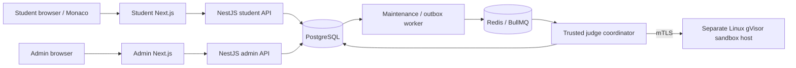

# Praduman's project guide

Reviewed against the checked-out source and private configuration on **24 October 2026**.
This explains the existing implementation; it is not a claim that production deployment,
Railway provisioning, judge isolation or 500-student load tests have passed today.

All Windows commands below run in **VS Code > Terminal > New Terminal > PowerShell**, from:

```powershell
Set-Location 'D:\myProjects\redResumes\Assignment\assessment-platform'
```

## 1. What this project does

Students sign in, see assigned assessments, start an eligible assessment, work on stable
question assignments, save separate Python/Java/C++ drafts, run public tests, submit solutions,
and finalize an assessment. Administrators manage students, immutable question versions,
assessment schedules and assignments, monitoring, results and audit records.

The initial DSA configuration is **180 minutes, four questions: two Easy, one Medium and one
Hard**. The admin configuration supports other validated rules. Rules, ownership, allocation,
deadlines and scores are enforced by the backend and database.

There are exactly three application packages:

| Folder      | Responsibility                                                                           | Local address                |
| ----------- | ---------------------------------------------------------------------------------------- | ---------------------------- |
| `frontend/` | Student Next.js App Router application and Monaco workspace                              | http://localhost:3000/login  |
| `backend/`  | NestJS API, Prisma, authentication, administration, queues, maintenance and judge source | http://localhost:4000/api/v1 |
| `admin/`    | Separate Next.js administrator application                                               | http://localhost:3001/login  |

The repository root `package.json` delegates startup to `assessment-platform/`. The actual
pnpm workspace, lockfile, shared contracts, infrastructure and scripts are inside that folder.
Extra backend processes do not constitute a fourth application folder.



Locally, the shared NestJS application can serve both student and admin routes. The production
template runs the same backend image as separate `api` and `admin-api` processes with different
database permissions and secrets. The sandbox broker has **no database connection, Redis
credentials or testcase encryption keys**.

## 2. The complete application flow

### Login and sessions

1. The browser obtains a CSRF token from `GET /api/v1/auth/csrf`.
2. Login sends the student ID, or the administrator email and ADMIN role, to `/auth/login`.
3. The backend checks account status and rate limits using PostgreSQL, then verifies the hash.
4. New passwords use Argon2id. Supported older Argon2/bcrypt hashes can be upgraded after a
   successful verification; plaintext passwords and arbitrary legacy hash formats are not accepted.
5. The backend generates a random session token, stores its hash in `auth_sessions`, and sets an
   HTTP-only cookie. This is server-side session authentication; there is no required JWT secret.
6. `/auth/me` restores the identity. Backend guards enforce authentication, role and ownership.
   Logout revokes the database session and clears cookies.

CSRF uses the request origin, a signed token and session binding. Production cookies use
`Secure`, `SameSite=Lax`, path `/`, and the `__Host-assessment_session` name without a Domain.
On localhost, use separate browser profiles for student and admin: ports do not isolate cookies.

Source: [authentication](assessment-platform/backend/src/modules/auth/),
[session guard](assessment-platform/backend/src/common/guards/session.guard.ts).

### Start, questions, drafts and expiry

1. Dashboard data comes from the assessment APIs and persisted assignments, not frontend arrays.
2. The backend confirms admission time, account eligibility and assignment before starting.
3. A transaction locks the assignment, deduplicates the request and creates/reuses its attempt.
4. Allocation chooses suitable published versions from the assessment's pinned pool. Attempt
   questions, rule snapshots, `startedAt` and `expiresAt` are persisted once.
5. Refresh/re-login reads the same attempt. Editing a question later creates a new version;
   it does not rewrite an existing student's published question.
6. Drafts are keyed by attempt question and language. Saves require ownership, an active attempt
   and the expected revision. Stale revisions produce a conflict instead of overwriting newer code.
7. The browser displays a timer synchronized to server timestamps; PostgreSQL time enforces
   the deadline. Browser clock changes cannot authorize a start or extend an attempt.
8. Final submission or server-controlled expiry locks the final snapshots and schedules evaluation.
   Maintenance reconciles expiry even when the browser is closed.

Source: [attempt lifecycle](assessment-platform/backend/src/modules/attempts/attempts.service.ts),
[workspace](assessment-platform/frontend/features/attempts/assessment-workspace.tsx).

### Run Code, Submit Solution and final scores

1. The API validates language, source size, ownership, deadline, idempotency and submission limits.
2. A database transaction persists the submission and an `outbox_events` row.
3. The maintenance worker dispatches the outbox to BullMQ. Redis jobs contain identifiers and
   generation metadata, not source text, passwords or hidden testcase contents.
4. The judge coordinator loads the durable submission, pinned toolchain and authorized testcase
   material, then calls the separate sandbox broker over mutually authenticated TLS.
5. gVisor guests compile/run student code with bounded resources, restricted filesystem and
   network access. Student code is never run as an unrestricted API child process.
6. Judge results are persisted in PostgreSQL. Public feedback may include public case results;
   hidden feedback follows the release policy and never exposes hidden inputs/expected outputs.
7. Final grading settles assessment results from locked snapshots with database coordination.
   Queue delivery can repeat; durable state, leases and generation checks protect accepted work.

When execution is unavailable, the UI reports that condition. An editor that loads, or an API
with a healthy database, does not prove that code execution is working.

## 3. Which database is configured right now?

The private files inspected for this guide select **Docker PostgreSQL**, not Railway:

| Item                                    | Configuration snapshot                                                  |
| --------------------------------------- | ----------------------------------------------------------------------- |
| Database engine                         | PostgreSQL 17 development infrastructure                                |
| Active provider                         | `docker` in `.local/config.json`                                        |
| Database name / identifier              | `assessment_dev`                                                        |
| Database username                       | `assessment_dev`                                                        |
| Host and published port                 | `127.0.0.1:5432`                                                        |
| Local Compose project                   | `assessment-local-f685d007`                                             |
| Database URL                            | Private `backend/.env`, key `DATABASE_URL`                              |
| Local database password                 | Private `.env`, key `POSTGRES_PASSWORD`, also encoded in `DATABASE_URL` |
| Railway profile                         | `.local/railway.json` is absent in this checkout                        |
| Railway project/environment/service IDs | Not recorded by a completed launcher setup                              |

These are configuration facts, not a live connectivity check. The development override selects
the PostgreSQL 17 major version; inspect a running server for its actual patch version. Ports and
the checkout-derived Compose project may differ on another machine.

The Railway account you identified is **pratyakshchauhan744@gmail.com**. An account email does
not select the database used by this code. A private connection URL and completed provider profile
select it. The existing `.local/railway-setup.json` is an incomplete setup journal; its generated
password is not evidence of a running Railway database. Earlier Railway provisioning was blocked
on 21 October; this guide does not assume that outage is still active today.

There may be other databases in your Railway account. They are not silently adopted by the
launcher. After successful explicit provisioning, `.local/railway.json` records `projectId`,
`environmentId`, `serviceId`, the verified URL and an endpoint fingerprint.

### Where to find the actual password and login IDs

Passwords are deliberately not copied into this committable guide. The following commands show
the **actual local values on your own terminal**, without inventing defaults. Do not paste their
output into GitHub, screenshots or public issues.

Development student/admin IDs, passwords and provisioning/verification flags:

```powershell
Get-Content '.local/credentials.json'
```

Database connection details, including its decoded password:

```powershell
node -e "const fs=require('node:fs'); const {parseEnv}=require('node:util'); const e=parseEnv(fs.readFileSync('backend/.env','utf8')); const u=new URL(e.DATABASE_URL); console.log(JSON.stringify({host:u.hostname,port:u.port||'5432',database:decodeURIComponent(u.pathname.slice(1)),username:decodeURIComponent(u.username),password:decodeURIComponent(u.password)},null,2));"
```

The PostgreSQL login, student login, admin login and Railway account are four different kinds
of credentials. Student/admin passwords are stored as hashes in `users`; existing hashes cannot
be decrypted to recover forgotten passwords. `.local/credentials.json` contains separately
preserved development credentials, not a way to read every student's original password.

### See the real database

With the configured PostgreSQL running, open Prisma Studio against the existing backend config:

```powershell
pnpm.cmd --filter @assessment/backend exec prisma studio --port 5555 --browser none
```

Open **http://localhost:5555**. This connects to the real configured database; it is not a mock
data screen. Prisma Studio can edit records: do not expose it publicly or bypass application
rules by casually editing active attempts or published records. See the [Prisma Studio guide](https://www.prisma.io/docs/studio/getting-started).

Alternatively use pgAdmin or DBeaver with the host, port, database, username and private password
above. For Railway, use the selected PostgreSQL service's Data/Connect and Variables panels;
external Windows clients need its reachable public TCP endpoint and verified TLS configuration.
An internal `*.railway.internal` hostname is not a Windows localhost database address.

Important model/table groups are in [schema.prisma](assessment-platform/backend/prisma/schema.prisma):

| Data                          | Tables                                                                                                                      |
| ----------------------------- | --------------------------------------------------------------------------------------------------------------------------- |
| Identities and authentication | `users`, `students`, `admins`, `auth_sessions`, `login_rate_limits`                                                         |
| Assessment setup              | `assessments`, `assessment_rules`, `assessment_pool_questions`, `assessment_assignments`                                    |
| Versioned bank                | `questions`, `question_topics`, `question_versions`, `question_templates`, `test_cases`                                     |
| Student work                  | `assessment_attempts`, `attempt_questions`, `code_drafts`, `submissions`                                                    |
| Grading and operations        | `submission_results`, `assessment_results`, `outbox_events`, `idempotency_records`, `judge_worker_heartbeats`, `audit_logs` |

Data lives in the PostgreSQL Docker volume locally, not in Prisma's schema file or an Excel sheet.
The schema describes it; migrations create/change it. `Questions/` contains source/reference
datasets and a generator. The application seeds use `backend/prisma/` fixtures; those spreadsheets
are not automatically imported into the live question bank.

## 4. Where every kind of environment key comes from

An environment variable can be a password, URL, file path, identifier or ordinary setting.
Not every variable is an external API key. This project does not need a Monaco API key or an
OpenAI API key to edit, compile or judge Python/Java/C++.

The normal local generator is
[scripts/local/environment.mjs](assessment-platform/scripts/local/environment.mjs). It preserves
existing usable values, generates missing secrets using Node's cryptographic `randomBytes`,
and backs up changed environment files under `.local/backups/`. A value present now may have
been preserved from an earlier setup; its original creator cannot always be reconstructed.
`.local/environment-report.json` records configuration categories without secret values.

| Variable(s)                                                                  | Source and purpose                                                                        | Production equivalent                                                                      |
| ---------------------------------------------------------------------------- | ----------------------------------------------------------------------------------------- | ------------------------------------------------------------------------------------------ |
| `POSTGRES_DB`, `POSTGRES_USER`, `POSTGRES_PORT`                              | Local infrastructure configuration; compose/launcher defaults                             | Provisioned PostgreSQL database, separate workload login and port                          |
| `POSTGRES_PASSWORD`                                                          | Existing local setting or newly generated 32-byte random secret                           | Database/provider-managed workload credential in a secret manager                          |
| `DATABASE_URL`                                                               | Local generator builds it from PostgreSQL settings; Railway setup supplies a verified URL | Restricted student/auth database LOGIN URL with verified TLS                               |
| `ADMIN_DATABASE_URL`                                                         | Same development DB locally; separate admin pool when configured                          | Separate privileged admin LOGIN, only in the admin API                                     |
| `DATABASE_JUDGE_URL`                                                         | Private judge environment                                                                 | Judge-only LOGIN with reviewed grants                                                      |
| `DATABASE_MAINTENANCE_URL`                                                   | Private maintenance environment                                                           | Maintenance-only LOGIN                                                                     |
| `DATABASE_METRICS_URL`                                                       | Optional private load/metrics configuration                                               | Read-only monitoring LOGIN                                                                 |
| `DATABASE_POOL_MAX` and other `*_POOL_MAX`                                   | Bounded connection counts, not secrets                                                    | Calculate the sum across every replica and worker                                          |
| `REDIS_QUEUE_URL`                                                            | Local Redis host/port, logical DB 0                                                       | Private persistent Redis endpoint; ACL/TLS credentials from its operator                   |
| `REDIS_SESSION_URL`                                                          | Configured logical DB 1                                                                   | Reserved/configured connection; sessions currently remain in PostgreSQL                    |
| `JUDGE_QUEUE_PREFIX`                                                         | Checkout-derived local namespace                                                          | Same environment-specific prefix across API, maintenance and judges                        |
| `CSRF_SIGNING_KEY`                                                           | Existing setting or cryptographically generated local secret                              | Persistent shared random secret for the API replicas; no public frontend exposure          |
| `DEV_STUDENT_*`, `DEV_ADMIN_*`                                               | Explicit local credentials or launcher-generated values; private credentials file         | Do not deploy development identities/password variables; use approved account provisioning |
| `SESSION_COOKIE_NAME`, `SESSION_SECURE`, session TTLs                        | Authentication settings                                                                   | Secure host-only cookie policy and reviewed TTLs                                           |
| `APP_ORIGINS`, `ADMIN_ORIGINS`, `TRUST_PROXY_HOPS`                           | Localhost origins and proxy topology                                                      | Exact HTTPS origins and actual trusted proxy count                                         |
| `NEXT_PUBLIC_API_BASE_URL`                                                   | Public relative `/api/v1` configuration                                                   | Same-origin browser API path; never put a password here                                    |
| `BACKEND_API_URL`                                                            | Server-side NestJS origin used by Next.js                                                 | Reachable internal API origin, supplied at build and runtime where needed                  |
| `PUBLIC_TESTCASE_KMS_KEY_ID`                                                 | Identifier of the PUBLIC keyring entry                                                    | Active public testcase key ID; not the AES secret itself                                   |
| `HIDDEN_TESTCASE_KMS_KEY_ID`                                                 | Identifier of the HIDDEN entry, judge environment                                         | Active hidden testcase key ID                                                              |
| `JUDGE_DIAGNOSTICS_KMS_KEY_ID`                                               | Identifier of the DIAGNOSTICS entry                                                       | Active private diagnostics key ID                                                          |
| `TESTCASE_KEYRING_FILE`                                                      | Private JSON holding independent PUBLIC/HIDDEN/DIAGNOSTICS AES keys                       | Read-only secret file mounted into the trusted judge                                       |
| `QUESTION_KEYRING_FILE`                                                      | Authoring subset containing PUBLIC/HIDDEN keys                                            | Mounted only into the privileged admin/authoring API                                       |
| `SANDBOX_TOOLCHAIN_CATALOG`                                                  | Built toolchain catalog with approved IDs, digests and commands                           | Reviewed immutable catalog, retained for historical versions                               |
| `SANDBOX_CA_FILE`, `SANDBOX_CERT_FILE`, `SANDBOX_KEY_FILE`                   | Local judge setup creates CA/client/server certificates using OpenSSL                     | Operator/PKI-issued CA and workload certificates, mounted privately                        |
| `SANDBOX_CLIENT_FINGERPRINTS`                                                | SHA-256 fingerprints of authorized client certificates                                    | Reviewed allowlist, changed during controlled certificate rotation                         |
| `SANDBOX_RUNSC_PATH`, `SANDBOX_RUNSC_SHA256`                                 | Reviewed installed gVisor binary path and actual hash                                     | Verified host provisioning, not a random generated token                                   |
| `SANDBOX_BROKER_URL`                                                         | Private HTTPS broker endpoint                                                             | Private reachable mTLS endpoint on the isolated Linux execution host                       |
| `EXECUTION_ENABLED`                                                          | Explicit capability flag, initially false during setup                                    | Enable only after successful real judge verification and healthy workers                   |
| `LOGIN_*`, `ARGON2_*`, `EXECUTION_MAX_PENDING_*`, concurrency/limit settings | Validated policy and resource limits                                                      | Tune against measured workloads while retaining bounds                                     |
| `NODE_ENV`, `HOST`, `PORT`, `LOG_LEVEL`                                      | Process settings                                                                          | Production mode, container binding, platform port and reviewed logging                     |

The `*_KMS_KEY_ID` names do **not** mean an AWS/GCP/Azure KMS client is implemented. Current
testcase encryption uses a private file-based key provider and AES-256-GCM. Each data class has
distinct 32-byte material, nonces and authenticated context. Keep all historical key IDs/material:
deleting an old key can make immutable published cases impossible to decrypt.

The local full keyring normally lives at `backend/sandbox/secrets/keyring.local.json`, with an
authoring subset beside it. `.local/config.json` records the selected paths. Judge mTLS material
is normally under `.local/judge/certs/`. Keyring files, certificates/private keys, environment
backups and credential files must be backed up privately, not committed.

Railway account authorization is handled by the Railway CLI's own login store outside this
source tree. It is not a student login or an application env key. The launcher saves its
resource journal/profile in ignored `.local/`, never in `NEXT_PUBLIC_*` variables.

## 5. How Monaco Editor works

Source: [code-editor.tsx](assessment-platform/frontend/features/attempts/code-editor.tsx),
[workspace](assessment-platform/frontend/features/attempts/assessment-workspace.tsx),
[prepare-monaco.mjs](assessment-platform/scripts/prepare-monaco.mjs).

- The project installs `@monaco-editor/react` and `monaco-editor` through pnpm. Monaco is the
  browser code editor; it does not execute student programs.
- The workspace dynamically imports the editor with `ssr: false`, because it requires browser APIs.
- `prepare-monaco.mjs` copies the installed Monaco distribution and notices to
  `frontend/public/monaco/`. `dev` and `build` invoke it automatically.
- `loader.config({ paths: { vs: '/monaco/vs' } })` serves those assets from the same application
  origin. There is no Monaco service account, hosted editor API key or required editor CDN.
- Only `PYTHON`, `JAVA` and `CPP` are selectable. They map to Monaco's `python`, `java` and `cpp`.
- Each question/language has a model URI such as `assessment:///QUESTION_ID/python`, backed by
  its own controlled draft. Switching languages does not reuse another language's source.
- Highlighting, indentation, brackets, line numbers, themes, font size and supplied snippets are
  editor features. The configured suggestions are snippets/word suggestions, not a full Python,
  Java or C++ language-server integration with compiler-grade analysis.
- Ctrl+S requests a save; Ctrl+Enter requests a public run. Server-provided diagnostics can
  become Monaco markers. Judge execution occurs through backend APIs, not inside Monaco.

Autosave debounces edits for 800 ms, also attempts a flush every 5 seconds while editing is
allowed, serializes saves per buffer and sends the expected server revision. It retries transient
failures and shows saved only after persistence is confirmed. Pending unsaved buffers have a
`sessionStorage` recovery copy scoped to the student and attempt; PostgreSQL is the durable
saved-draft source. A refresh, tab suspension or network error does not create a fresh exam timer.

The asset preparation script includes a narrowly guarded Safari clipboard cancellation fix for
the pinned Monaco artifact. Dependency upgrades require reviewing that guard, not removing the
check or hand-editing generated `public/monaco/` files. Production images must contain both the
copied public Monaco files and Next standalone static assets.

## 6. How Redis and BullMQ work

PostgreSQL stores identities, sessions, questions, attempts, drafts, accepted submissions and
results. **Redis is the job transport and coordination infrastructure.** A configured
`REDIS_SESSION_URL` does not make it the session store: `AuthRepository` uses `auth_sessions`.
Login rate-limit records are also stored in PostgreSQL in this implementation.

The local `redis` service in `docker-compose.yml` has a persistent volume, append-only
persistence, a 512 MB bound and `noeviction`. Its unauthenticated port is bound to loopback for
development; do not copy that exposure/authentication policy to production.

| Queue                  | Purpose                                         |
| ---------------------- | ----------------------------------------------- |
| `judge-public-v1`      | Evaluate public Run Code requests               |
| `judge-submissions-v1` | Evaluate hidden submissions and final work      |
| `attempt-finalize-v1`  | Coordinate scheduled expiry/finalization work   |
| `judge-dead-letter-v1` | Record exhausted evaluation jobs for operations |

Queue names are isolated by `JUDGE_QUEUE_PREFIX`. Default jobs have three attempts and
exponential retry backoff. Judge worker concurrency is bounded separately for public and hidden
work. The durable outbox and maintenance recovery bridge SQL state and queue delivery; repeated
jobs are expected to be handled safely. A Redis `PONG` alone does not prove grading works.

For production use private authenticated Redis, persistent storage, reviewed memory limits and
`noeviction`; use verified `rediss://` when the endpoint supports TLS. Select a BullMQ-compatible
service with the required Redis behavior rather than assuming every HTTP-only/serverless Redis
offering works. Monitor waiting time, queue depth, retry/dead-letter rates, worker heartbeats and
storage. Follow [BullMQ's production guidance](https://docs.bullmq.io/guide/going-to-production).

## 7. Run locally and seed the database

Prerequisites: Node **24.12+ within major 24**, pnpm **10.34.6**, and Docker Desktop's Linux/WSL2
engine. On a low-memory Windows PC, run builds/tests sequentially. The complete local judge
requires substantially more resources than simply loading the applications.

```powershell
npm.cmd install --global pnpm@10.34.6
$env:Path = "$env:APPDATA\npm;$env:Path"
pnpm.cmd --version
pnpm.cmd local:up --skip-judge
```

Keep the terminal open. Core startup configures environments, starts PostgreSQL/Redis, installs
the lockfile, validates/generates Prisma, applies migrations, provisions missing development
accounts, prepares actual encrypted fixtures and starts the API, both web apps and maintenance.
Even core mode prepares question/toolchain metadata and may download/build prerequisites.
`--skip-judge` disables actual execution; it must not show fabricated passes or completed grades.

For the complete local judge setup and gate, use `pnpm.cmd local:up` instead. A failed cached gate
can be retried with `--retry-judge` after fixing the underlying runtime/network/resource issue.
Do not run two supervisors for the same checkout at once.

```powershell
# Another terminal: check the running stack.
pnpm.cmd local:check
Invoke-RestMethod 'http://localhost:4000/api/v1/health/live'
Invoke-RestMethod 'http://localhost:4000/api/v1/health/ready'

# Stop local services, preserving data and private configuration.
pnpm.cmd local:down
```

If infrastructure/environment setup is already complete, `pnpm.cmd dev` starts the three
development app servers. Separate VS Code terminals can use `dev:backend`, `dev:frontend` and
`dev:admin`. That command does not replace migrations, seeds, maintenance or judge provisioning.

| Manual command, if needed     | Real entry point / effect                                                               |
| ----------------------------- | --------------------------------------------------------------------------------------- |
| `pnpm.cmd db:validate`        | Validate Prisma schema; does not prove DB connectivity                                  |
| `pnpm.cmd db:generate`        | Generate the Prisma client consumed by the backend                                      |
| `pnpm.cmd db:migrate`         | Run reviewed `prisma migrate deploy` migrations                                         |
| `pnpm.cmd dev:student`        | Provision an explicit missing development student with Argon2id                         |
| `pnpm.cmd dev:admin-user`     | Provision an explicit missing development administrator                                 |
| `pnpm.cmd db:seed`            | `seed.ts` / `dev-seed.ts`: dashboard/editor fixtures; not a real judge bank             |
| `pnpm.cmd db:seed:judge`      | `seed-judge.ts` / `judge-seed.ts`: encrypted execution bank, real keys/catalog required |
| `pnpm.cmd db:seed:local`      | `seed-local.ts`: reuse/create an open local practice round from the judge fixtures      |
| `pnpm.cmd worker:maintenance` | Compiled maintenance process with private `.env.maintenance.local`                      |
| `pnpm.cmd worker:judge`       | Compiled judge coordinator with private `.env.judge.local`                              |

`local:up` orchestrates its required seed order. For manual judge seeding supply the preserved
`TESTCASE_KEYRING_FILE` and `SANDBOX_TOOLCHAIN_CATALOG` to the seed process. Existing account
passwords, immutable question versions and historical assessment schedules are preserved on
rerun. Do not reset a database or delete volumes/keyrings to make a seed rerun succeed.

## 8. What Railway setup does and does not do

```powershell
pnpm.cmd railway:login
pnpm.cmd railway:up
```

Login authorizes the official pinned Railway CLI using your account. The explicit workflow
creates a separate development project, PostgreSQL 17 service, volume and public TCP proxy,
deploys the reviewed TLS image in `scripts/railway/postgres/`, exports only its public CA through
authenticated SSH, then prepares `assessment_dev`. It saves resource identities and verified TLS
settings in `.local/railway.json`, followed by the normal migrations, seeds and local app startup.

`railway:setup` performs the database stage alone. `local:up --railway --skip-judge` can start core
applications against an already completed profile. A fresh checkout uses Docker; after selecting
Railway, the provider is persisted. Do not edit the profile to point at an arbitrary production DB.

This is **cloud development database + local applications**, not automatic public deployment of
student/admin/API or a production sandbox. Redis remains local in that mode. `local:down` does
not stop Railway resources or their billing. Preserve private setup progress and historical keys;
retry after a provider error instead of creating replacement secrets or deleting existing data.

For production, use Railway's private networking for services in the same authorized
project/environment and keep public database access tightly controlled. Your Windows computer
cannot directly resolve those private service names. See [Railway private networking](https://docs.railway.com/networking/private-networking).

## 9. How to take this to production

### Required deployment boundaries

Use a separate production database and secrets, not the local demonstration accounts or database.
Plan these independently deployable processes from the existing three source folders:

| Process                 | Required access                                                                                           |
| ----------------------- | --------------------------------------------------------------------------------------------------------- |
| Student Next.js         | Internal student API; no DB, Redis or testcase keys                                                       |
| Admin Next.js           | Internal admin API; no DB, Redis or testcase keys                                                         |
| Student API             | Restricted auth/student SQL login, queue configuration, shared CSRF secret                                |
| Admin API               | Shared auth SQL login plus separate privileged admin login and authoring key subset                       |
| Maintenance             | Its own SQL login and Redis; no testcase keys/broker certificates                                         |
| Judge coordinator       | Its own SQL login, Redis, full testcase keyring, approved catalog and mTLS client identity                |
| Sandbox broker / guests | Dedicated Linux host, verified gVisor/toolchains, server/client trust policy; no SQL/Redis/keyring access |
| Migration job           | Short-lived DBA identity; never reuse it in a runtime container                                           |

The existing production templates are under `infra/deploy/`. If you host the web/API/data
services on Railway, create separate services for these processes and use the **whole
`assessment-platform/` build context**; the app Dockerfiles depend on the shared lockfile/scripts.
Choose `frontend/Dockerfile`, `admin/Dockerfile` or the appropriate `backend/Dockerfile` target.
Railway hosting by itself does not provide or verify the required isolated gVisor broker.

### Configure data, identities and secrets

1. Provision private PostgreSQL 17 and persistent BullMQ-compatible Redis. Configure TLS and
   backups before an exam uses them. Verify DNS/ports from the actual deployed workloads.
2. Review `backend/prisma/runtime-grants.sql`. It creates **NOLOGIN permission groups** such as
   `assessment_api`, `assessment_admin`, `assessment_judge` and `assessment_maintenance`.
   A DBA must create separate LOGIN identities and grant the appropriate group to each.
   URLs must use the actual LOGIN identity, not a NOLOGIN group copied from an example.
3. Put workload passwords/URLs and a persistent random CSRF signing secret in private platform
   variables or a secret manager. Generate production values independently of development.
4. Provision the testcase keyring and mTLS identities as restricted read-only files. A secret
   manager may deliver those files, but the code currently expects files, not a direct KMS API.
5. Configure exact HTTPS origins, `SESSION_SECURE=true`, `__Host-assessment_session`, correct
   proxy hops and internal backend URLs. Restrict the admin origin/network as appropriate.
6. Set server-only `BACKEND_API_URL` during Next Docker builds and runtime. Rewrites are compiled
   at build time; changing only the running environment is insufficient for a compiled rewrite.
7. Keep `EXECUTION_ENABLED=false` until the real judge gate and healthy-worker checks succeed.
   Never use local development seed/provision commands to create production accounts.

### Build and release

Run checks and image builds sequentially on a suitably provisioned machine/CI runner. These
Docker commands build artifacts; replace the example tags with your reviewed registry/revision.
Supply a reviewed immutable `NODE_IMAGE` build argument for a production release.

```powershell
pnpm.cmd install --frozen-lockfile
pnpm.cmd validate
pnpm.cmd test:backend
pnpm.cmd test:frontend
pnpm.cmd test:admin
pnpm.cmd build
pnpm.cmd exec playwright install chromium
pnpm.cmd exec playwright test
pnpm.cmd security:audit

docker build --target api -f backend/Dockerfile -t assessment-api:reviewed .
docker build --target maintenance -f backend/Dockerfile -t assessment-maintenance:reviewed .
docker build --target judge -f backend/Dockerfile -t assessment-judge:reviewed .
docker build --target migrate -f backend/Dockerfile -t assessment-migrate:reviewed .
docker build -f frontend/Dockerfile -t assessment-frontend:reviewed .
docker build -f admin/Dockerfile -t assessment-admin:reviewed .
```

Publish scanned images to your registry and configure their actual `@sha256:` digests in a
private deployment env file based on `infra/deploy/.env.example`. The checked-in examples
intentionally contain invalid hosts/digests/password placeholders and fail deployment validation.
The repository CI performs checks/builds; it does not provision your production secrets or
automatically deploy a completed production fleet.

On the trusted Linux application host, from `assessment-platform/`:

```sh
node scripts/check-deployment.mjs /etc/assessment/deployment.env
docker compose --env-file /etc/assessment/deployment.env -f infra/deploy/docker-compose.prod.yml --profile migration run --rm migrate
docker compose --env-file /etc/assessment/deployment.env -f infra/deploy/docker-compose.prod.yml up -d --wait
```

Before the migration job, take a verified backup, restore it into a separate rehearsal database,
review migrations and existing-user compatibility, and plan locking/cutover. `db:migrate` does
not automatically apply the optional runtime grants script. Never use `migrate reset`,
`db push --accept-data-loss` or development fixtures on production data.

Deploy judge coordinators separately using `infra/deploy/docker-compose.judge.yml`. Provision
the sandbox host using `backend/sandbox/README.md` and `infra/systemd/`. Run the independent
real judge gate and failure/recovery tests before routing exams to it. Do not mount an API host's
Docker socket into the API, web apps or judge coordinator.

### Public URLs, monitoring, backups and capacity

- Use separate student/admin HTTPS hostnames. The Caddy template terminates HTTPS and routes
  each same-origin `/api/v1` to its appropriate API. Configure DNS and ACME access. An admin
  frontend permission check is not a replacement for backend roles or database permissions.
- Monitor `/api/v1/health/live` and `/api/v1/health/ready`, structured Pino logs, database pool
  utilization, storage, queue waiting age, evaluation failure rates and fresh judge heartbeats.
  Prometheus/blackbox/alerts templates are in `infra/monitoring/`; configure real private exporters.
- Back up PostgreSQL with WAL/PITR where available, Redis persistence, historical encryption
  keys, catalog/digests and certificate trust material. Test restores; SQL data alone cannot
  recover encrypted testcases if the keys are lost. Backup/rehearsal scripts are in `infra/backup/`.
- Budget SQL connections across **all** API/admin/maintenance/judge replicas and leave operational
  headroom. Add reviewed pooling and scale bounded worker concurrency against actual CPU/memory
  and sandbox slots. Queue backpressure is necessary during submission/expiry spikes.
- Use the existing `scripts/load/assessment.k6.js`, `load:prepare`, `load:run` and `load:metrics`
  workflow against isolated production-like infrastructure. Record 500 authenticated students,
  p50/p95/p99, errors, pools, queue delay/depth, throughput, completion time and judge resources.
  **No measured 500-concurrent-student capacity is established by this guide.**

The detailed deployment/security/load documents remain useful references. Their early Step 5
statements about this Windows machine having no Docker are historical; distinguish those dated
records from today's configuration and fresh test results.

## 10. Files cleaned up and files that must stay

This review stopped tracking the duplicated installed Prisma assistant references under
`backend/.agents/` and `backend/.claude/`, their `skills-lock.json`, and personal
`.vscode/settings.json`. Local copies are preserved. They are development-tool metadata, not
application source, migrations or runtime dependencies. Git ignore rules now prevent re-adding
them. Docker and formatting exclusions also omit the installed reference packages.

The redundant conversational `assessment-platform/readmeunderstand.md` was removed; the
maintained README and this guide contain its startup instructions. The folder-inventory generator
now excludes private `.local/` state and assistant references, and describes the implemented admin.

Also ignored: local environment files, private credential notes/keys, database exports and
Python/OS caches. Root `praduman.private.md` is reserved for any personal untracked credential
notes you deliberately create; this guide does not generate a second plaintext password copy.

Do **not** delete these as cleanup:

| Keep                                                               | Reason                                                                     |
| ------------------------------------------------------------------ | -------------------------------------------------------------------------- |
| `pnpm-lock.yaml`, workspace configuration and `patches/`           | Reproducible dependencies and reviewed fixes                               |
| `backend/prisma/migrations/`, invariants and grants                | Durable schema history and security boundaries                             |
| `contracts/openapi.json`, generated API types and contract sources | Client/backend compatibility and architectural interfaces                  |
| Tests, load scripts, deployment files and security documentation   | Verification and release requirements                                      |
| `Questions/` reference datasets                                    | Original user/source data; not build output                                |
| Ignored `.local/`, backend keyrings, catalogs and local envs       | Existing passwords, trust, encrypted-data keys and pinned runtime metadata |
| Docker database volumes                                            | Actual persisted student and assessment data                               |

`.next/`, `dist/`, generated Prisma code, copied Monaco assets, dependencies, reports and logs
are generated/ignored and can be regenerated when their tools are available. Do not treat
`.local/` or encryption keyrings as disposable just because Git ignores them. Avoid broad
`git clean -fdx` or `docker compose down -v` commands on a working assessment installation.

## 11. Useful source references

- [Main setup and commands](assessment-platform/README.md)
- [Current folder inventory](assessment-platform/docs/folder-structure.md)
- [API contracts](assessment-platform/contracts/openapi.json)
- [Database schema and adoption strategy](assessment-platform/docs/database.md)
- [Local launcher behavior](assessment-platform/docs/local-development.md)
- [Production deployment templates and process](assessment-platform/docs/step-5-deployment.md)
- [Sandbox host and toolchains](assessment-platform/backend/sandbox/README.md)
- [Independent real judge gate](assessment-platform/docs/judge-test-gate.md)
- [Security hardening](assessment-platform/docs/step-5-security.md)
- [Load-test preparation and evidence requirements](assessment-platform/docs/step-5-load-testing.md)

## 12. Checks performed for this review

- Scaffold validation passed: exactly three application packages and 69 API contracts.
- The source inventory was regenerated with 484 source/configuration/documentation files,
  excluding installed assistant references and private local state.
- All 19 local links in this guide resolve, and 12 representative private/tool/generated paths
  were confirmed ignored. Local copies of the untracked assistant/editor files still exist.
- The guide was checked against actual private local passwords/signing/encryption values;
  none of those values was copied into this file.
- Targeted ESLint, Prettier and Git whitespace checks passed for the changes.

Application builds, the full integration/browser suites, a live database connection, cloud
provisioning and the real judge/load gates were **not rerun for this documentation cleanup**.
The commands above describe how to execute them; they are not fresh passing test results.

No production secret, original database, existing account password, published question or student
attempt was changed as part of writing this guide and cleaning repository tracking.
